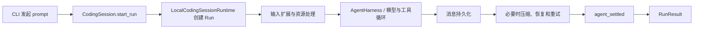

# Tau Run Runtime 中文改造说明

## 1. 改造目标

本次改造借鉴计算机操作系统对“进程/任务”的管理方式，把 Tau 中一次 Agent 执行从
“调用一个异步生成器并等待它结束”，提升为一个拥有明确身份和生命周期的 **Run**。

改造前，一次请求虽然能够调用模型、执行工具并输出答案，但调用方很难统一回答下面的
问题：

- 当前请求是否仍在运行？
- 这次请求的唯一标识是什么？
- 模型停止输出后，消息是否已经持久化？
- 请求是成功、失败还是被取消？
- 前端错过部分事件后，能否从已知位置继续读取？
- 多个调用方是否会同时修改同一个会话？

改造后，每次执行由 Run Runtime 管理，具备唯一 ID、状态机、事件序号、结果对象、取消
入口、控制消息入口和进程内事件重放能力。

这项工作是 Phase 26 RPC 和 Phase 27 Python SDK 之前的运行时基础，不等同于已经实现
RPC 或 Python SDK。

## 2. 总体架构

本次实现保留 Tau 原有三层边界：

```text
tau_ai      模型与 Provider 流式传输
tau_agent   可复用的 Agent Harness、循环、工具与通用 Run 模型
tau_coding  CodingSession、持久化、压缩、扩展、CLI 与 TUI
```

Run Runtime 分为两层。

### 2.1 通用 Agent Run

位置：`src/tau_agent/runtime/`

这一层描述可移植的运行概念，不依赖 Typer、Rich、Textual、会话文件位置或 CodingSession。
主要模型包括：

- `RunStatus`：Run 生命周期状态；
- `RunSnapshot`：某一时刻的不可变运行快照；
- `RunResult`：终态快照和本次产生的消息；
- `RunEvent`：带 Run ID、事件序号和时间戳的事件信封；
- `RunBudget`：为未来调度器预留的资源预算结构；
- 本地 Run Handle：观察、等待、取消、steer 和 follow-up 的控制接口。

### 2.2 CodingSession Run

位置：`src/tau_coding/runtime.py`

CodingSession 的一次完整请求不仅包含 AgentHarness 循环，还包含输入扩展、资源处理、消息
持久化、上下文压缩、溢出恢复、自动重试和清理。因此，CodingSession 使用外层 Run 将
这些工作统一包裹起来。



内外两层的职责不同：

```text
Agent Run          管理一次可移植 Harness 执行
CodingSession Run  管理包含持久化和应用策略的完整用户请求
```

## 3. 生命周期状态

Run 使用显式状态机：

```text
created → queued → starting → running
                               ├→ succeeded
                               ├→ failed
                               ├→ cancelled
                               └→ timed_out
```

当前本地 CodingSession 通常从 `starting` 进入 `running`，最后到达以下终态之一：

- `succeeded`：Agent 执行和持久化收尾均成功；
- `failed`：Provider、工具、扩展、协议或持久化失败；
- `cancelled`：收到取消请求，并完成取消后的修复和清理；
- `timed_out`：模型已预留，当前本地 CodingSession 尚未提供完整超时调度策略。

终态不可再次跳转，非法状态迁移会立即报错。

## 4. `agent_end` 与 `agent_settled`

本次新增的关键边界是 `agent_settled`。

```text
agent_end      Agent 核心循环已经停止
agent_settled  持久化、压缩/重试和清理均已结束，最终状态可以确定
```

可以把它类比为：

```text
agent_end      程序主函数返回
agent_settled  数据刷盘、资源释放并确定进程退出码
```

前端、未来 RPC 服务和 SDK 不应只看到 `agent_end` 就认定请求成功，而应等待
`agent_settled` 或 `RunResult`。

## 5. Run Handle

`CodingSession.start_run(prompt)` 返回 `CodingRunHandle`。主要能力如下：

```python
run = session.start_run("检查这个项目")

run.run_id                          # 本次请求的唯一标识
run.snapshot                        # 当前状态快照
run.events(after_sequence=0)        # 订阅或重放事件
await run.result()                  # 等待最终结果
run.cancel()                        # 请求取消
await run.steer("先检查测试")        # 当前执行中的引导消息
await run.follow_up("然后总结风险")  # 当前执行完成后的后续消息
await run.aclose()                  # 强制关闭并等待清理
```

事件信封包含：

- `run_id`：事件属于哪个 Run；
- `sequence`：从 1 开始、严格递增的事件序号；
- `timestamp`：事件时间；
- `event`：原始 Tau Agent/CodingSession 事件。

## 6. 主流程接入

### 6.1 CodingSession

`src/tau_coding/session.py` 增加了：

- `start_run()` 和 `start_continue_run()`；
- 同一个 CodingSession 的执行租约，阻止并发请求互相污染；
- Run 与旧 `prompt()` 调用之间的冲突保护；
- 树状会话写入锁；
- 持久化失败后的 session poison，防止在上下文不可信时继续写入；
- 取消时未完成工具调用的修复与持久化；
- session 关闭时对外部 Run Runtime 的清理。

一次 Run 覆盖完整请求，而不是只覆盖模型调用：

```text
输入 hook
→ 资源展开
→ Harness 尝试
→ 工具调用
→ 消息持久化
→ 自动压缩
→ 上下文溢出恢复
→ 自动重试
→ agent_settled
```

### 6.2 Print Mode CLI

`src/tau_coding/cli.py` 的普通 Agent prompt 已改为调用：

```python
run = session.start_run(prompt)
```

CLI 消费 `run.events()` 渲染原有回答，并通过 `await run.result()` 决定退出码。终态为
`failed` 或 `cancelled` 时，CLI 不再把“生成器停止”误判为成功。

终端快捷命令 `!`、`!!` 和被 slash command 直接处理的请求不会创建 Agent Run，因为
它们没有进入 Agent 主循环。

### 6.3 渲染器

Text、Transcript 和 JSON 渲染器增加了上下文溢出恢复后的正确成功判断：第一次模型调用
因上下文过长失败、自动压缩并重试成功时，最终回答仍按成功结果渲染，CLI 退出码也是 0。

### 6.4 TUI

本次只修复了 TUI 在新 Run 互斥边界下的兼容问题，例如 `/new` 会等待旧 Worker 释放会话
租约。Textual 主输入流程尚未正式改为持有 `CodingRunHandle`，这是下一阶段工作。

## 7. `--trace-run` 可观测入口

真实模型对话可以这样观察：

```powershell
py run_tau_local.py -p --trace-run "请使用 read 工具读取 pyproject.toml，然后总结主要依赖"
```

普通回答写入标准输出，Run trace 写入标准错误。不开启 `--trace-run` 时，原有输出保持
不变。默认 trace 会隐藏高频的 `message_start`、`message_update`、`message_end` 和
`tool_execution_update`，并在结束时输出合并计数。

典型输出：

```text
[tau run] created run_id=... session_id=... status=starting
[tau run] event sequence=01 type=agent_start
[tau run] event sequence=02 type=turn_start
[tau run] event sequence=... type=tool_execution_start
[tau run] event sequence=... type=tool_execution_end
[tau run] stream-summary message_end=4 message_start=4 message_update=493
[tau run] event sequence=507 type=agent_settled
[tau run] settled status=succeeded events=507 turns=2 tools=1 messages=4
[tau run] replay after=505 sequences=[506, 507]
[tau run] persistence=settled
```

`events=507` 不代表执行了 507 个任务。模型流式输出的每个小片段都会产生
`message_update`，因此长回答可能有数百个事件。真正适合判断工作量的字段是：

- `turns`：模型推理轮数；
- `tools`：工具调用次数；
- `messages`：最终完整消息数；
- `status`：完整请求的最终状态。

需要调试底层流式协议时，可显式输出全部原始事件：

```powershell
py run_tau_local.py -p --trace-run-events "检查项目"
```

`--trace-run-events` 会隐含启用 `--trace-run`，长回答可能产生数百行输出，正常观察时不
建议使用。

## 8. 持久化边界

Run 事件与会话消息采用不同的存储策略。

### 8.1 仅保存在内存中的信息

- `run_id`；
- Run 状态变化；
- 事件 sequence；
- `agent_start`、`message_update`、`agent_settled` 等完整事件流；
- 用于 replay 的事件缓冲。

这些信息保存在 `LocalCodingSessionRuntime` 的 Run Handle 中。当前只能在同一个进程、同
一个 CodingSession 生命周期内重放；print mode 结束并退出进程后，这些事件会消失。

### 8.2 写入 JSONL 的信息

- 用户、Assistant 和工具消息；
- Session 基本信息；
- 模型与 thinking level 变化；
- 会话树 leaf；
- 压缩摘要；
- 扩展自定义条目。

默认存储位置：

```text
~/.tau/sessions/<项目路径和哈希>/<session-id>.jsonl
```

恢复会话时，Tau 使用持久化的完整消息和压缩摘要重建模型上下文，不会重新加载数百条
流式 `message_update`。

当前每次 print mode 都创建一个新 session，因此下一次 `-p` 不会自动接续上一次对话；
TUI 可以使用 `--session <session-id>` 恢复对应会话。

### 8.3 容量与敏感数据风险

当前 JSONL 是 append-only 存储。自动压缩只缩小后续发送给模型的活动上下文，不会删除
硬盘上的原始消息，因此超长会话仍可能持续增长；恢复会话时还需要读取整个 JSONL。

普通文本通常增长缓慢，主要风险来自：

- 大量 Bash 输出和工具结果；
- 工具读取到的敏感配置或密钥被写入会话；
- 图片以 Base64 放进 `ImageContent` 或工具结果 `details`；
- print mode 反复创建新 session，但旧 session 没有自动过期；
- 扩展向 `CustomEntry` 写入大型对象。

Base64 通常比原始二进制大约多三分之一。当前图片消息模型已经存在，`read` 工具读取
图片时也会把完整 Base64 放入结果 details；但 Provider 适配层尚未把这些图片块完整转换
为模型图片输入。这意味着现阶段可能产生图片存储成本，却没有完整获得多模态能力。

在加入正式多模态支持前，应先完成：Blob 外置与内容寻址、单会话/全局配额、无引用 Blob
回收、敏感工具结果持久化策略，以及 JSONL vacuum。当前继续使用默认
`C:\Users\User\.tau`，不增加磁盘迁移或自定义数据盘逻辑。

## 9. 并发、取消和失败处理

本次实现补充了以下安全边界：

- 同一 CodingSession 同时只允许一个拥有者执行关键操作；
- 旧 Run 的迟到控制消息不能修改新 Run；
- 重复取消是幂等的，不会重复注入取消异常；
- 取消期间仍会修复并持久化中断的工具调用；
- Provider 自发抛出的取消异常不会被误判为用户取消；
- 存储自身取消或写入失败会使 Run 进入 `failed`；
- 持久化失败后会阻止不安全的下一次请求；
- 多个观察者可以读取同一条规范事件流；
- 慢扩展 handler 不会阻止事件先进入 Run 缓冲。

## 10. 与改造前的差异

### 改造前

```python
async for event in session.prompt("问题"):
    render(event)
```

调用方只能观察生成器是否结束，需要自行推断成功、失败、取消和持久化状态。

### 改造后

```python
run = session.start_run("问题")

async for envelope in run.events():
    render(envelope.event)

result = await run.result()
```

调用方获得了：

- 稳定身份；
- 显式生命周期；
- 完整终态；
- 事件顺序；
- 进程内重放；
- 统一取消；
- 会话互斥；
- 可验证的持久化完成边界。

## 11. 主要代码文件

```text
src/tau_agent/runtime/               通用 Run 类型与本地运行时
src/tau_agent/harness.py             Harness 与 Run Runtime 的接入
src/tau_agent/__init__.py            通用 Run API 导出
src/tau_coding/runtime.py            完整 CodingSession Run Runtime
src/tau_coding/session.py            生命周期、租约、持久化和恢复边界
src/tau_coding/cli.py                Print mode 与 --trace-run
src/tau_coding/rendering/plain.py    文本渲染终态处理
src/tau_coding/rendering/json.py     JSON 渲染终态处理
src/tau_coding/rendering/transcript.py Transcript 渲染终态处理
src/tau_coding/tui/app.py            TUI 兼容性收尾
```

## 12. 当前限制与下一步

当前限制：

1. Run 事件只在内存保存，进程重启后不能 replay；
2. 详细模式仍会输出每个流式 update，仅适合协议调试；
3. Textual TUI 主 prompt 尚未持有 Run Handle；
4. 尚未实现跨进程 RPC、远程 Run 查询或 Python SDK；
5. 尚未实现 Run 事件保留上限和淘汰策略；
6. `RunBudget` 目前只是模型，尚未由调度器执行。

建议的下一步顺序：

1. 让 Textual TUI 保存当前 `CodingRunHandle`，统一取消、steer 和 replay；
2. 为内存事件增加数量/字节上限和淘汰策略；
3. 增加 Session/Blob 容量统计、配额、GC 和 vacuum；
4. 完成 Blob 外置后再接通 Provider 多模态输入；
5. 设计持久化 Run 元数据，但继续避免持久化逐 token update；
6. 在上述边界稳定后实现 Phase 26 RPC；
7. 最后基于 RPC/本地 Runtime API 实现 Phase 27 Python SDK。

## 13. 本次清理说明

为了让改造结果更集中，本次按项目维护者要求进行了清理：

- 删除本次新增的独立测试文件；
- 从原有测试文件中移除本次新增的测试用例；
- 删除两个假 Provider 演示脚本；
- 删除本次新增的多份英文 ADR 和架构说明；
- 恢复本次对原有英文网站文档的修改；
- 保留核心功能代码、真实 CLI 观察入口和本中文文档。

原仓库已有测试与文档未被整体删除，用户本地配置和启动脚本也未被修改。
